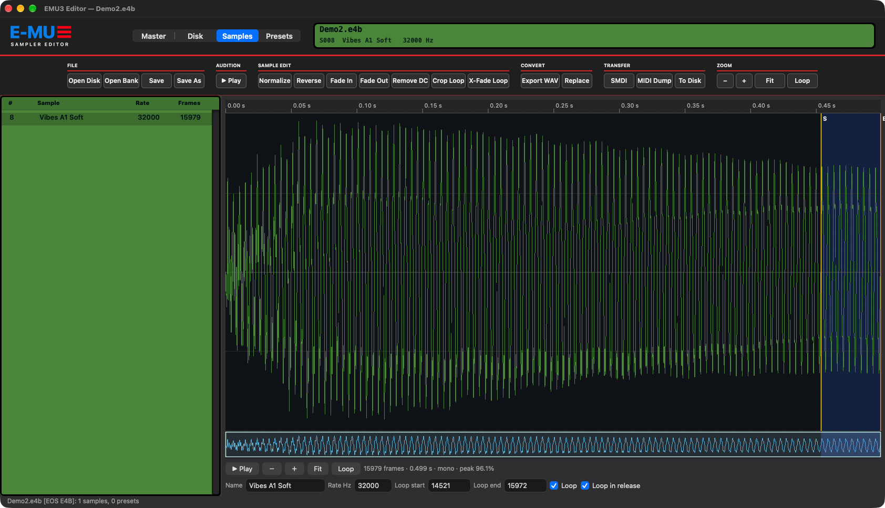
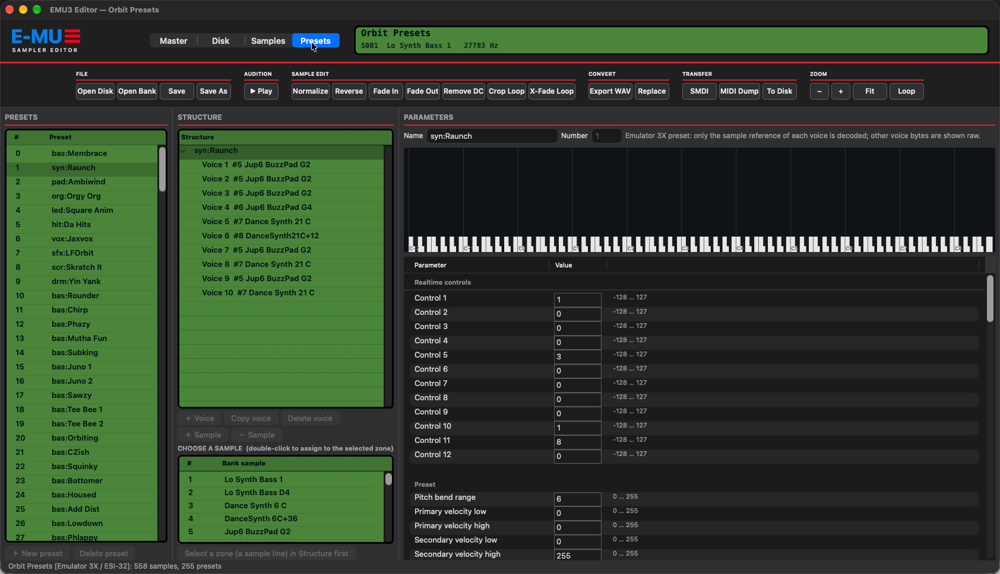
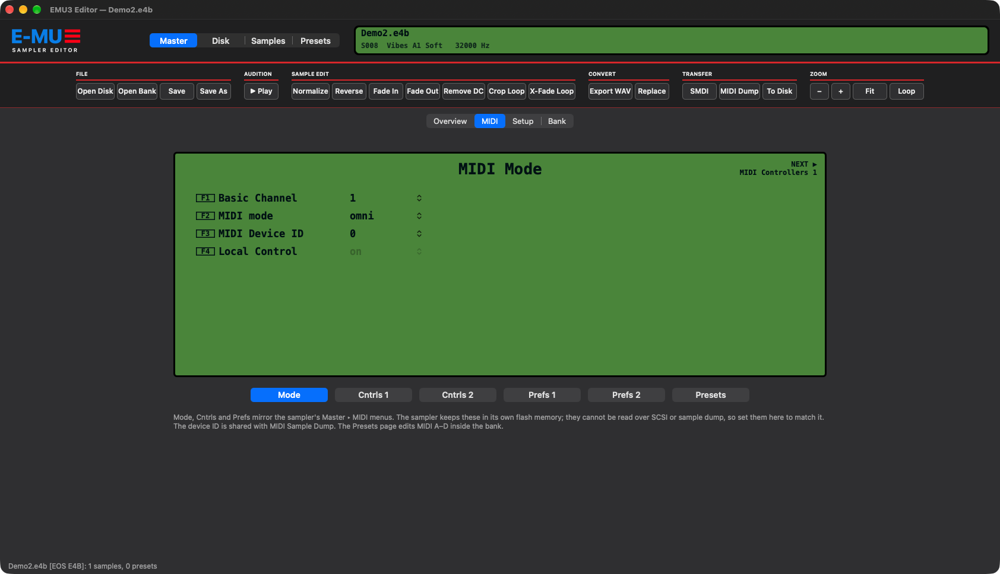
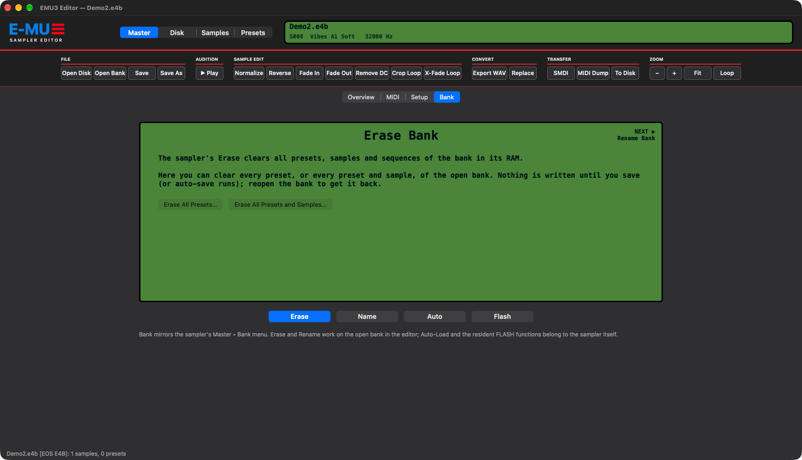

# EMU3 Editor

**Work in progress.** This is an early, actively changing project. Things are missing, some parts are
untested on real hardware, and files can be written wrongly. Always keep a copy of your banks and disk images; the
app writes a backup of a bank to `~/Library/Application Support/EMU3 Editor/Backups` before it saves, but don't rely on that alone.
See [docs/STATUS.md](docs/STATUS.md) for what is verified and what is not.

A native macOS editor for the banks, presets and samples of E-mu EOS samplers (E64, E6400, ESI-32 and relatives).
It opens a disk image or a single bank file, and lets you edit samples and presets the way the sampler's own
menus describe them. It is the companion to [EMU3 Disk Manager](https://github.com/Mistahbrock/EMU3-Disk-Manager),
which serves a disk image to the sampler over USB (BlueSCSI) and mounts images in Finder.

Free software under the GNU General Public License, version 3. See [LICENSE](LICENSE).

## Screenshots

**Samples**: waveform, draggable loop markers, zoom, audition, and the sample edit tools.



**Presets**: preset list, voice and zone structure, and the parameter table (shown here with an Emulator 3X bank).



**Master**: the sampler's Master menus (MIDI, Setup, Bank) rebuilt as LCD pages, with soft keys and PREV / NEXT paging on the arrow keys.




## What it does

- Opens EOS disk images (`.hda`, `.iso`) and bank files, both Emulator IV / EOS (E4B) and Emulator 3X / ESI-32 banks.
- Sample editor: waveform, loop start and end, normalize, reverse, fades, DC removal, crop to loop, crossfade loop, WAV export and replace, audition with the sustain loop.
- Preset editor: add, copy and delete presets, voices and zones, assign samples, edit the parameters (E4 presets in full; 3X presets are shown with the sample references decoded and the rest raw).
- Master pages (MIDI, Setup, Bank) modelled on the sampler's menus. The sampler keeps its master settings in flash memory and they cannot be read or written over SCSI, so these pages are a reference profile to match the sampler by hand. Erase and rename work on the open bank.
- Sends samples to the sampler over MIDI Sample Dump (SMDI / MIDI Dump); presets travel inside the bank file.
- Optional auto-save to the sampler disk when you change something (off by default).

## Build

Requires macOS and Xcode, plus [XcodeGen](https://github.com/yonaskolb/XcodeGen).

```bash
xcodegen generate
xcodebuild -project EMU3Editor.xcodeproj -scheme EMU3Editor -configuration Release build
```

Model tests (synthetic banks, no sampler data):

```bash
bash Tests/run-tests.sh
```

## Installer

```bash
Installer/build-installer.sh
```

This writes `dist/EMU3Editor-<version>.pkg`, which installs for the current user, with no administrator password:

- EMU3 Editor in `~/Applications/Rhyno Audio`
- Emu_Imager (disk images and SD cards) as an Add On, in `~/Library/Application Support/EMU3 Editor/Add Ons`,
  where the editor lists it in its Tools menu

Emu_Imager is built from its own project, expected in a folder named `Emu_Imager` next to this one. Set
`IMAGER_DIR` to use another folder, or `IMAGER_DIR=none` to build the installer without it.

Before installing, the package moves other copies of these apps to the Trash: app bundles with their identifiers
(renamed copies too) in `/Applications`, `~/Applications` and the Add Ons folder, and zip files there that hold only
one such app. Banks, backups, settings and build folders are not touched. The package is not signed with a
Developer ID or notarized, so another Mac will warn before opening it.

## Documentation

- [docs/STATUS.md](docs/STATUS.md): what is done, verified on real data, and still unverified.
- [docs/EOS-MANUAL-NOTES.md](docs/EOS-MANUAL-NOTES.md): notes taken from the EOS manual, including the Master ▸ Setup pages.
- [docs/SMDI.md](docs/SMDI.md): notes on SCSI sample transfer.

## How this was made

EMU3 Editor was built by me together with [Claude](https://claude.ai), an AI assistant from [Anthropic](https://www.anthropic.com). I decided what the program should do and how it should behave. I tested it on my own sampler, and I'm responsible for what's published here. Claude wrote much of the code.

Some people have strong feelings about AI, and I understand that. For me it's a tool in the same family as the sampler: the sampler lets me play instruments I could never afford or carry, and create new sounds that don't exist in real life, and this let me build software I couldn't have written alone. Either way, the point is the music and the people who make it. If you'd rather not use software made this way, that's a fair choice. Everything is open source and the code is there to read.

## Support

Free and open source, made in my spare time for E-mu owners. If it saved you time, you can
[buy me a coffee](https://www.paypal.com/donate/?hosted_button_id=92QGBZBYGBBXY). It keeps the updates coming. ☕

## License and credits

GPLv3. See [CREDITS.md](CREDITS.md). E-mu, Emulator and EOS are trademarks of their owners; this project is independent and not affiliated with them.
